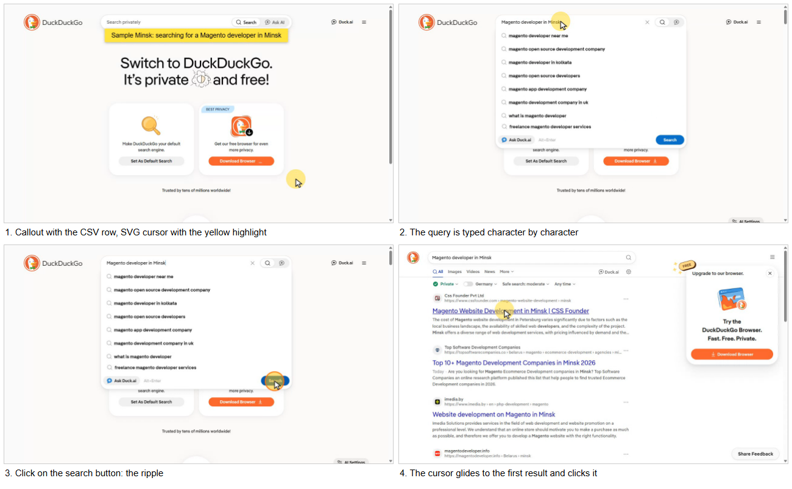

# CSV-driven browser automation video recorder

[](https://github.com/Yarik002/csv-video-recorder/actions/workflows/ci.yml)

Test task: Python + Playwright (sync API, Chromium). `capture_video.py` reads a CSV and, for every row, calls `qscript.CaptureVideo_Magento(...)`. The function opens the page, shows an SVG cursor with a yellow highlight, glides to the search box, types `Magento developer in <city>` like a person, clicks the search button and then the first result. Every click shows a ripple. Playwright records it all into `video/<company_name>.webm`.



A full recording made by this code: [docs/sample.webm](docs/sample.webm) (37 s, opens in the browser).

## Run

Python 3.9 or newer. On Windows:

```bash
git clone https://github.com/Yarik002/csv-video-recorder.git
cd csv-video-recorder
py -m venv .venv
.venv\Scripts\activate
pip install -r requirements.txt
python -m playwright install chromium
python capture_video.py
```

On Linux or macOS the same, with `python3 -m venv .venv` and `source .venv/bin/activate`.

Output:

```
[1/3] Acme Retail GmbH (Berlin)
  saved: C:\...\csv-video-recorder\video\Acme Retail GmbH.webm (32 s)
[2/3] Nordic Home; Garden AB (Stockholm)
  saved: C:\...\csv-video-recorder\video\Nordic Home; Garden AB.webm (33 s)
[3/3] Atlantic Supplies Ltd (Manchester)
  saved: C:\...\csv-video-recorder\video\Atlantic Supplies Ltd.webm (33 s)
Done: 3 of 3 videos saved.
```

A browser window opens for each row; this is on purpose, see "Headless" below. Options:

```bash
python capture_video.py other.csv --video-dir out    # another CSV and output folder
python capture_video.py --headless                   # no window (DuckDuckGo blocks it)
```

## Files

| File | What it does |
|---|---|
| `qscript.py` | `CaptureVideo_Magento(...)` with the exact signature, the global `PATH_TO_VIDEO_FOLDER = "./video"`, the sample behaviour, the injected cursor/highlight/ripple/callout and the `ShowCallout` helper |
| `capture_video.py` | Reads the CSV with `csv.DictReader(f, delimiter=";", quotechar='"')` and calls the function for every row, prints the saved path. Exit code 1 if any row failed |
| `input.csv` | Sample input, 3 rows. The second company name contains `;` inside quotes to show the quote handling |
| `requirements.txt` | Only `playwright` |
| `tests/` | Offline tests on a local copy of the search flow, run in CI on Python 3.9, 3.12 and 3.14 |
| `docs/NOTES.md` | Problems I ran into and how I solved them |

## How it works

**Visual effects.** One JS snippet is added with `context.add_init_script` (a plain IIFE, so it runs on every page, including the results page and the opened site). It creates a 32×32 SVG arrow (white fill, black outline), a semi-transparent yellow circle with radius 32 px centred on the pointer and placed behind the arrow, and listens to `mousemove`. All elements have `pointer-events: none` and the top `z-index`, so they never take clicks. Styles are set through `element.style` and animations through `element.animate`, because sites with a strict CSP block injected `<style>` tags; the SVG is built with `createElementNS`, because `innerHTML` is blocked on sites with Trusted Types. The cursor position is kept in `sessionStorage`, so after a navigation on the same site the cursor stays where it was.

**Mouse.** The real Playwright mouse (`page.mouse`) is moved along a slightly curved path with ease-in-out, about 60 steps per second, so the cursor never teleports. Clicks are real `mousedown`/`mouseup` events, so the browser does the default action (form submit, link navigation). Before each click the ripple is started from Python and played for 0.3 s: the search click starts a navigation, and a ripple started on `mousedown` would be gone before it is painted.

**Typing.** `page.keyboard.type` one character at a time, with a random 60–160 ms delay and a longer pause after spaces.

**DuckDuckGo specifics.**
- `form button[type="submit"]` matches two buttons. The first one is hidden (0 px wide); the visible one appears in the suggestion box after typing. The code always takes the first *visible* match.
- The suggestion box grows while suggestions arrive, and the results list shifts while it loads. Before moving, the code waits until the target stops moving, and after the move it checks that the cursor is still on it.
- The search is a full page navigation, so the old JS context is destroyed. Nothing is evaluated in the page at that moment: Python waits for the results with `wait_for_selector`, which survives the navigation, with a 30 s timeout (results are rendered client-side and can be slow).
- `ShowCallout` ignores a "context was destroyed" error: a callout is decoration and must not fail the run.

**Callout.** `window.ShowCallout(text, bgColor, textColor, fade)` in the page and `qscript.ShowCallout(page, text, bgColor, textColor, fade)` in Python. A yellow box with black 16pt text, sized to the text, 2 s fade-in and 2 s fade-out. The sample shows the company and the city from the CSV row.

**Video.** `browser.new_context(record_video_dir=PATH_TO_VIDEO_FOLDER, record_video_size=1280×720)`, viewport of the same size. After the scenario the context is closed (this writes the file), then the video is moved to `<PATH_TO_VIDEO_FOLDER>/<company_name>.webm` and the absolute path is returned. Characters that are not allowed in Windows file names are replaced with `_`. An existing file with the same name is replaced.

**CSV fields.** The sample uses `URL`, `City` and `Company Name`. `Language` becomes the browser locale (`de` gives the German DuckDuckGo interface; not a language code falls back to `en-US`, so the result does not depend on the recording machine). `Country`, `Postcode`, `Street` and `HouseNo` are accepted for the real Magento scenario and not used by the sample.

**Errors.** Each step has a name. If one fails, the function prints the step and the reason, closes the browser, keeps the partial video as `<company_name>.failed.webm` for debugging and returns `None`. `capture_video.py` goes on with the next row.

```
[2/2] Broken Co (Nowhere)
  failed at step 'open the page': TimeoutError: Page.wait_for_selector: Timeout 8000ms exceeded.
  partial video kept: ...\video\Broken Co.failed.webm
  FAILED
```

## Headless

`HEADLESS = False` in `qscript.py`, the browser runs with a window. I checked headless mode first: DuckDuckGo answers the search with its error page (`static-pages/home-error/418.html`), so the results never appear. With a window the same code works. I did not try to hide the automation from DuckDuckGo (user agent tricks and so on), it is not the point of the task. `--headless` stays for other sites.

## Tests

```bash
python -m unittest discover -s tests -v
```

They do not need the internet: a small local site in `tests/site/` copies the DuckDuckGo flow (a `textarea[name="q"]`, a form submit with a full navigation, results with `data-testid="result-title-a"` that appear after 1.5 s). The tests check:
- CSV reading: `;` inside quotes, `""` escapes, UTF-8 with or without BOM, empty lines, a missing column;
- in a real Chromium: arrow size and colours, the tip on the pointer, the highlight centred and behind the arrow, `pointer-events: none` (a click through the cursor still reaches the textarea), the ripple appears and disappears, the callout is 16pt and yellow, the cursor stays in place after a navigation;
- end to end: `capture_video.main()` on two rows; the good row gives `Good Co.webm` with a valid WebM header in a folder that did not exist, the server sees the typed query and the click on the first result; the broken row returns `None` and the exit code is 1.

## Checked by hand

On Windows 11, Python 3.11, against the live DuckDuckGo on 3 November 2026: `input.csv` (Berlin, Stockholm, Manchester) gave 3 of 3 videos, several runs in a row. I watched the frames of every video: the cursor, the highlight, the typing, the ripple on each click, the results and the opened first result. One thing I cannot control: the first result for Manchester was designrush.com, which shows its own "security verification" page, so that video ends on it.

## Not done

- No retries if DuckDuckGo is slow or changes its markup; the row fails with a clear step name instead.
- A first result that opens in a new tab is not handled (DuckDuckGo opens it in the same tab).
- The CI does not run the live DuckDuckGo scenario: CI has no screen, and DuckDuckGo blocks headless browsers. The live run was checked by hand, see above.

Made with an AI assistant (Claude); I went through the decisions and can explain them.
